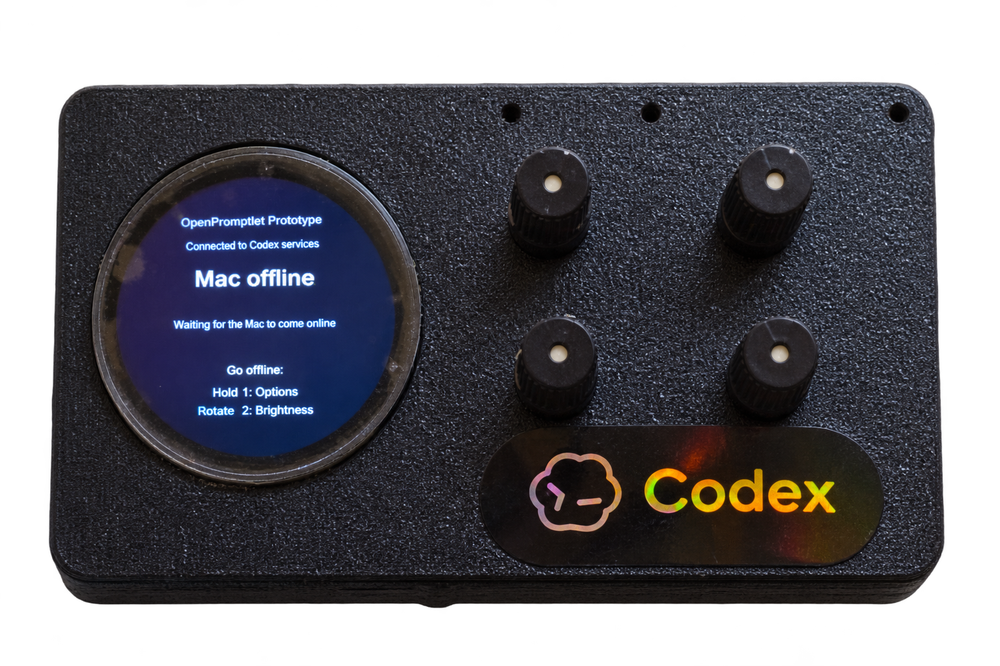
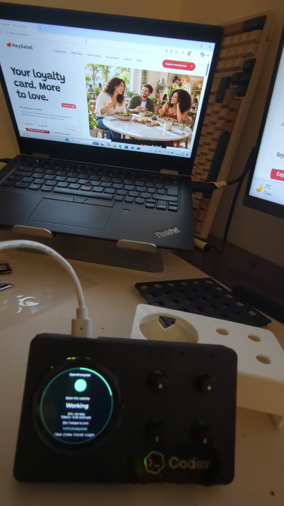

# OpenPromptlet · Codex Edition

Make the work visible.

*Real prototype photo, AI-retouched to remove the background, cable and exposed board. Screen details may differ. [Unedited photo](https://openpromptlet.com/assets/prototype-original-01.jpg).*

Four knobs, a round screen and a 3D-printed case. OpenPromptlet is the standalone control brick in the modular OpenDotlet project, built by HeySalad.

[Landing page](https://openpromptlet.com) · [Parts list](hardware/parts-list.md) · [STL files](hardware/stl) · [Setup guide](docs/setup.md) · [Firmware](firmware)

## Follow the work

“Open heysalad.ai and give me three improvements.”

Filmed on the actual prototype: the ESP32-S3 draws the moving dot and checkpoint ring while Codex uses the connected Windows browser. The main video is the full, uncut 2 minute 40 second camera recording, with the entire frame preserved and audio removed. The dot shows activity and the ring counts verified checkpoints; the computer runs Codex and its tools. Time/token ranges are estimates, and actual token usage was not reported.

[Watch the demo](https://openpromptlet.com/#task-demo-title) · [Full, uncut video](https://openpromptlet.com/assets/openpromptlet-esp-full.mp4) · [What was checked](docs/GREEN-DOT-DEMO.md)

The display update was installed with a fresh full-flash backup and the previous active application preserved. Voice capture, speaker playback and a physical knob-triggered launch are not demonstrated in this recording.

## What works today

The Axiometa Genesis Mini reads four AX22 rotary encoders and their push buttons. It sends events over ESP-NOW to the Waveshare round display. Turning changes a counter; pressing shows **CONFIRMED**. A local USB bench interface shows the inputs too. The display is rotated 180° for the current enclosure orientation.

All four knobs and presses were physically accepted on the prototype on 10 November 2026. On 12 November Peter confirmed the rotated display is upright and all four knobs still work. This repository packages that source; it has not been freshly flashed as part of publication.

## Build one

1. Check the [parts list](hardware/parts-list.md) and [enclosure fit notes](hardware/README.md) before printing.
2. Follow the [setup guide](docs/setup.md) to build and install the two firmwares, connect four modules and pair the boards.
3. Turn and press each control to verify the display feedback.

The two enclosure meshes are prototype design files. The LCD-1.46 mounting bracket is still an open mechanical item; a complete repeatable enclosure fit is not claimed. Battery operation and a separate keypad are outside this initial release.

## Ideas to try

- Select a saved prompt and confirm it with a press.
- Adjust parameters in a creative tool or local workflow.
- Show a timer or task status on the round display.

These are extension ideas. Prompt execution, AI integration and desktop automation are not implemented in the included firmware.

## Repository

| Path | Contents |
| --- | --- |
| [`hardware/`](hardware) | Parts list, two controller STLs and print/fit notes |
| [`firmware/screen/`](firmware/screen) | ESP-IDF round-display application; pinned dependency bootstrap |
| [`firmware/axiometa_encoder_screen_link/`](firmware/axiometa_encoder_screen_link) | Arduino four-encoder sender |
| [`tools/bench/`](tools/bench) | Local input interface, pairing and optional LAN updater tools |
| [`docs/setup.md`](docs/setup.md) | Assembly, build, USB installation and pairing |
| [`docs/provenance.md`](docs/provenance.md) | Source checkpoints and known limits |

The landing page includes the actual ESP display footage above. A physical knob-triggered browser task with onboard voice is still to be recorded.

## Contribute

Issues and pull requests are welcome. Useful first contributions include a verified LCD-1.46 bracket, a complete fastener list, repeatable assembly photos and software mappings for the controls. Include your board revisions and observed results when reporting a build.

## License

Original project code, documentation and enclosure meshes: [MIT](LICENSE). Vendor support code is fetched separately and retains upstream terms; see [third-party notices](THIRD_PARTY_NOTICES.md) before redistributing firmware builds. Third-party marks are excluded. OpenPromptlet is an independent project.

## Independence

Codex Edition describes this community build. OpenPromptlet is an independent HeySalad project, not affiliated with, sponsored by, or endorsed by OpenAI. Hardware and software remain prototypes.
